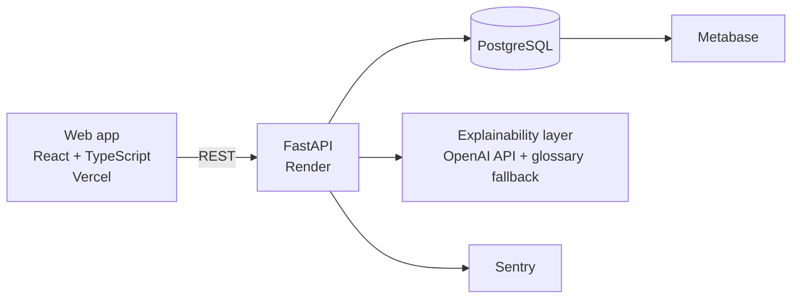

# Cairn

**Plan a life goal on paper with Pebble, a little robot that explains investing in everyday words.**

[Live demo](https://your-app.vercel.app) · [API docs](https://your-api.onrender.com/docs)


> Demo project built to explore goal-based investing. Simplified assumptions, not investment advice. Not affiliated with any company.

---

## What you can do

- **Set a goal** (retirement, a home, a safety net) and find your risk profile with six quick questions.
- **Watch your plan being sketched.** Pebble draws your projection on a notebook page. Drag the sliders and the range of possible outcomes reshapes instantly, with your chance of reaching the goal.
- **Understand every word.** Tap any finance term, or ask "What does this mean?", and Pebble explains it in plain French or English, with an everyday analogy.
- **Travel through time.** Scrub through the years and see your allocation shift from growth to safety as the goal approaches.
- **Replay a crisis.** See how your portfolio would have behaved in 2008, 2020 and 2022, with and without rebalancing.
- **Follow every euro.** Each deposit and rebalance is recorded in a double-entry ledger that always balances.

## How it works



The simulation, glide path, rebalancing and ledger are deterministic Python code covered by unit and property-based tests. The explainability layer receives the facts the engine already computed and rewrites them in everyday language. A guard checks that every number in an explanation comes from those facts; otherwise a written template is used. The app works fully without an OpenAI key.

The interface is drawn by hand, like a plan sketched on a notebook (or a blueprint, in dark mode), but every figure is rendered in a crisp, highly legible typeface.

## How this maps to the role

| Requirement | Where it lives |
|---|---|
| Python backend, FastAPI | `api/src/cairn` |
| PostgreSQL | SQLAlchemy 2.0 models, Alembic migrations |
| Robo-advisor algorithms | Monte Carlo engine, glide path, drift rebalancing in `api/src/cairn/domain` |
| Accounting reliability | Double-entry ledger, idempotent deposits, reconciliation endpoint |
| Quality and code review | ruff, mypy strict, pytest + Hypothesis, PR templates |
| CI/CD | GitHub Actions, Vercel and Render deployments |
| Monitoring and bug tracking | Sentry (API and web) linked to GitHub Issues, JSON logs, request IDs |
| Kubernetes, Metabase | `infra/k8s`, Metabase in Docker Compose |
| AI with discernment | Guarded explainability layer with fallbacks and caching, `docs/ai-usage.md` |
| Working with support and product | Plain-language explanations of every screen, ledger line and rebalance |

## Run locally

```bash
# API, database and Metabase
cp api/.env.example api/.env
docker compose -f infra/docker-compose.yml up --build

# Web app
cd web
cp .env.example .env
npm install
npm run dev
```

The app runs without an OpenAI key or Sentry DSN; those features fall back gracefully.

## Monitoring

- **Logs** are JSON lines (structlog). Every request gets an `X-Request-ID` (reused if the client
  sends one), which is returned in the response and attached to every log line.
- **Sentry** captures errors from the API and the web app when `SENTRY_DSN` / `VITE_SENTRY_DSN`
  are set; without them it is a no-op. Events carry the environment, the release (the git SHA,
  from `RENDER_GIT_COMMIT` on Render) and the request ID as a tag, so a Sentry event leads
  straight to the matching log lines.
- **Checking the setup:** with `ENVIRONMENT=local`, `GET /debug/sentry` raises a test error. The
  route does not exist in any other environment.

### From a Sentry issue to a GitHub issue

1. In Sentry, install the GitHub integration (Settings → Integrations → GitHub) and give it
   access to this repository.
2. In the project's settings, add the repository under *Code Mappings* (`api/src/` → `src/`,
   `web/src/` → `src/`) so stack traces link to the right lines.
3. On any Sentry issue, use **Link GitHub Issue** (or *Create GitHub Issue*). The GitHub issue
   gets the Sentry link, and the bug template asks for the request ID.
4. Mention `Fixes SENTRY-ID` (Sentry's short ID) in the pull request or commit that fixes it;
   Sentry resolves the issue when that release is deployed.

## Tests

```bash
cd api && uv run pytest        # unit and property-based tests
cd web && npm run test         # component and utility tests
```

## Decision records

- [0001 Integer cents and double-entry ledger](docs/adr/0001-integer-cents-and-double-entry.md)
- [0002 Drift-based rebalancing](docs/adr/0002-drift-based-rebalancing.md)
- [0003 Boundaries for the language model](docs/adr/0003-llm-boundaries.md)
- [0004 Demo scope without authentication](docs/adr/0004-demo-scope-without-auth.md)
- [0005 Hand-drawn interface with exact figures](docs/adr/0005-hand-drawn-ui-with-exact-figures.md)

## Build roadmap

The project was built in small, reviewable slices, one commit each. Full specifications are in [BUILD_PLAN.md](BUILD_PLAN.md).

| # | Slice | Commit message |
|---|---|---|
| 0 | Repository scaffold | `chore: scaffold monorepo with api and web tooling` |
| 1 | API skeleton and database | `feat(api): bootstrap FastAPI app with health check, logging and Postgres` |
| 2 | Risk profiles | `feat(domain): add risk questionnaire, profiles and model allocations` |
| 3 | Monte Carlo engine | `feat(simulation): add vectorised Monte Carlo goal projection` |
| 4 | Glide path | `feat(investment): add horizon-based glide path` |
| 5 | Goals and persistence | `feat(goals): persist goals with Alembic migrations and projection endpoint` |
| 6 | Double-entry ledger | `feat(ledger): add double-entry ledger with idempotent deposits and reconciliation` |
| 7 | Rebalancing | `feat(investment): add drift-based rebalancing posted to the ledger` |
| 8 | Stress tests | `feat(simulation): add historical stress-test replays` |
| 9 | Explainability layer | `feat(explain): add plain-language explainability layer with guarded GenAI and fallbacks` |
| 10 | Monitoring and CI | `ci: add GitHub Actions pipeline, Sentry monitoring and repo templates` |
| 11 | Notebook design system | `feat(web): add notebook design system, hand-drawn primitives and typed API client` |
| 12 | Pebble, the guide robot | `feat(web): add Pebble guide robot with explanations, tours and states` |
| 13 | Landing page | `feat(web): add landing page with self-sketching hero and Pebble intro` |
| 14 | Onboarding | `feat(web): add onboarding flow with sketched profile reveal` |
| 15 | Live simulator | `feat(web): add live simulator with hatched projection chart and explanations` |
| 16 | Dashboard, time machine, stress test | `feat(web): add goal dashboard, time-machine scrubber and stress-test replays` |
| 17 | Demo data, Metabase, Kubernetes | `chore: add demo seed data, Metabase setup and Kubernetes manifests` |
| 18 | Deployment | `chore(deploy): add Render blueprint and Vercel configuration` |
| 19 | Documentation | `docs: add architecture, decision records and AI usage notes` |

## Built with AI, reviewed by hand

Claude Code helped build this project slice by slice. Every slice had to pass linting, strict typing and tests before it was committed, and the money-handling code was reviewed line by line. See [docs/ai-usage.md](docs/ai-usage.md) for what worked and what was rewritten.
