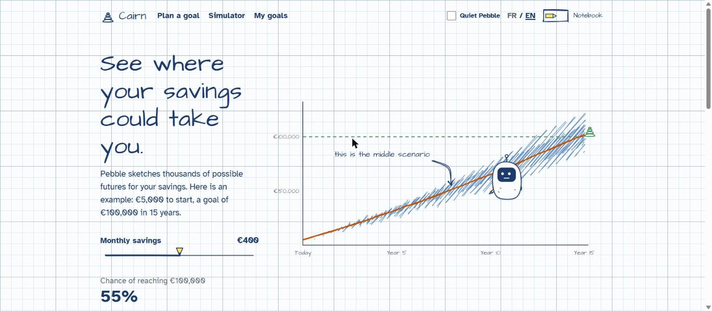
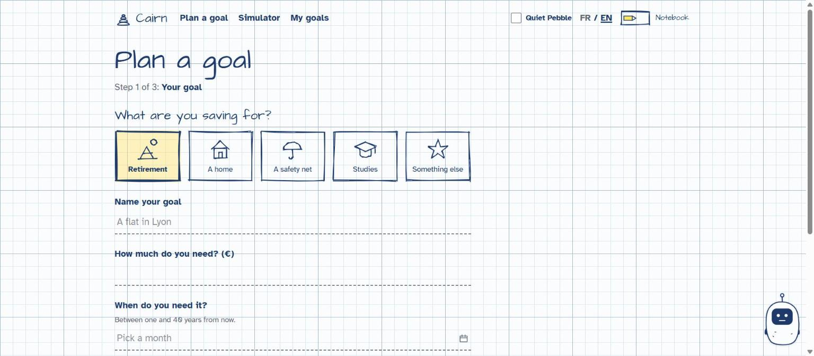
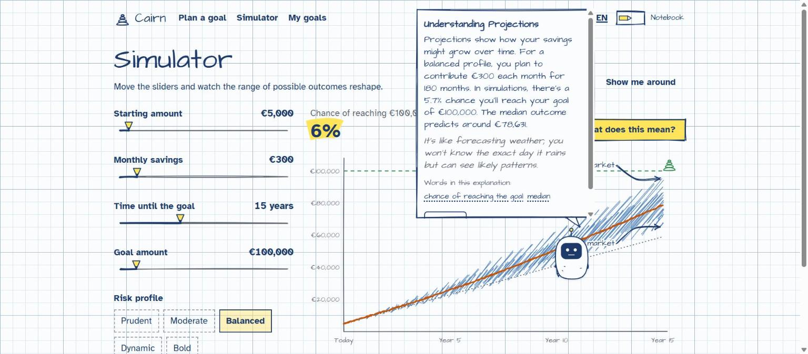
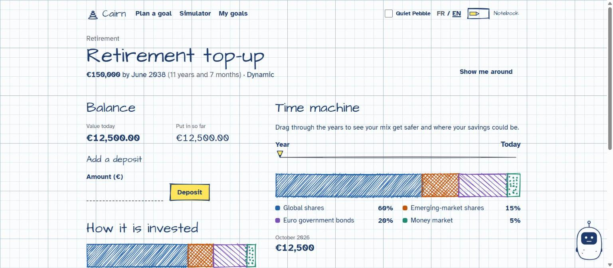
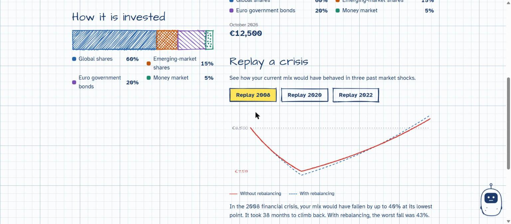
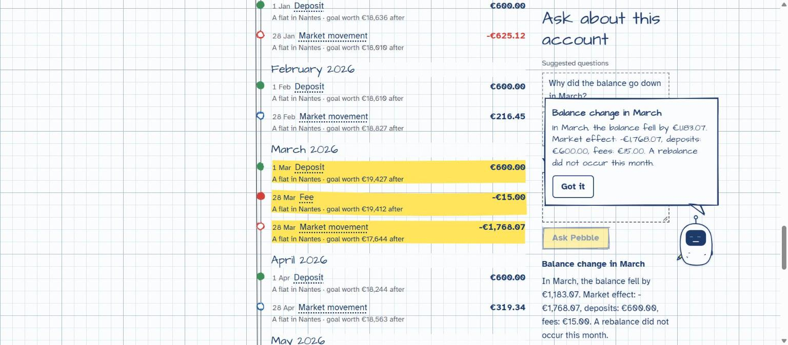
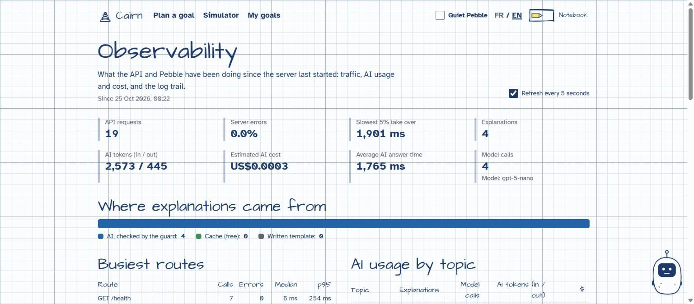
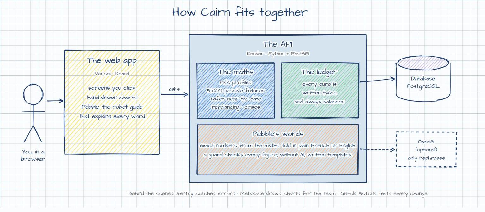

<div align="center">


# Cairn

**Plan a life goal on paper, with a little robot that explains investing in everyday words.**

[Live demo](https://your-app.vercel.app) · [API docs](https://your-api.onrender.com/docs)
<!-- Replace both links once deployed (see docs/deploy.md). -->



</div>

> A demo project. The assumptions are simplified, and nothing here is investment advice.

## Demo video


https://github.com/user-attachments/assets/013fcb3c-03d3-4482-b189-a43bef5621b6


<sub>Click the picture to play the video (22 seconds, with sound).</sub>

## What you can do

- **Set a goal.** A home, retirement, a safety net: give it a name, an amount and a date.
- **Find your risk profile** with five quick questions. Your goal date answers the sixth.
- **Watch your plan being drawn.** Move the sliders and see thousands of possible futures
  reshape, with your chance of reaching the goal.
- **Ask what anything means.** Pebble, the robot guide, explains every word and every number in
  plain French or English.
- **Travel through time.** Drag through the years and watch your money move from growth to
  safety as the date gets closer.
- **Replay a crisis.** See how your savings would have behaved in 2008, 2020 and 2022.
- **Follow every euro.** Each deposit, fee and rebalance is written down twice, so the books
  always balance.
- **Help a client** (support view). Search for someone, read their account as one timeline, and
  ask "why did my balance go down in March?". The answer adds up to the cent.
- **Keep an eye on things** (observability). Traffic, errors, AI usage and cost, and a log trail
  you can follow request by request.

## A look inside

| | |
|:---:|:---:|
|  |  |
| **Plan a goal** in three short steps | **The simulator**, with Pebble explaining |
|  |  |
| **Your goal**, today and through the years | **Crisis replay**, with and without rebalancing |
|  |  |
| **Support view**: a client's history, explained | **Observability**: traffic, AI usage and logs |

## How it works



- **The maths is ordinary code, and it is tested.** Projections, risk profiles and rebalancing
  never come from AI.
- **AI only rephrases.** It turns numbers that were already computed into plain words. A guard
  checks every figure it writes; if one is wrong, or there is no AI key, Pebble uses a sentence
  written by hand.
- **Money is counted in whole cents** in a double-entry ledger, so nothing can appear or vanish.
- **Hand-drawn, but exact.** Charts look sketched; numbers are always printed crisp.

## Try it on your computer

You need [Docker](https://www.docker.com/) and [Node.js](https://nodejs.org/).

```bash
# 1. The API, the database and Metabase
cp api/.env.example api/.env
docker compose -f infra/docker-compose.yml up --build

# 2. Demo data: a few goals and five support clients
docker compose -f infra/docker-compose.yml exec api python scripts/seed.py

# 3. The web app, at http://localhost:5173
cd web && cp .env.example .env && npm install && npm run dev
```

It works without an OpenAI key. Add one to `api/.env` to let Pebble rephrase with AI.

## Learn more

- [Engineering notes](docs/engineering.md): code map, tests, monitoring, the build roadmap
- [Decision records](docs/adr/): why things are built the way they are
- [Deploying](docs/deploy.md) to Vercel and Render
- [How AI helped build this](docs/ai-usage.md)

<div align="center"><sub>Built with FastAPI, PostgreSQL, React, Rough.js and a lot of pencil lines.</sub></div>
